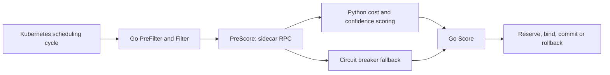

# Kube-Sentinel

Kube-Sentinel is a native Kubernetes scheduler plugin validated on GKE for placement constraints, telemetry validation, cost-aware ranking and scoring-daemon fallback/recovery.

Kube-Sentinel is a portfolio engineering project. The current baseline is [v0.1.0](https://github.com/Aravind0403/Kube-Sentinel/releases/tag/v0.1.0). The native plugin and Python scoring daemon have completed local cluster validation and bounded live validation on Google Kubernetes Engine (GKE Standard) across all 8 acceptance scenarios (L1–L8). Complete raw evidence is committed at [artifacts/gke-acceptance/gke-20261022-235720/](artifacts/gke-acceptance/gke-20261022-235720/).

## What it does

- Keeps protected latency-critical workloads off recognized Spot capacity (`cloud.google.com/gke-spot=true`).
- Filters CPU architecture, GPU requirements, explicit cost ceilings, and unacceptable telemetry.
- Uses a Python sidecar for cost and telemetry-confidence scoring.
- Keeps native Go filters active when the sidecar is unavailable; a circuit breaker supplies neutral fallback scores.
- Tracks placement commit/rollback through scheduling lifecycle hooks.

Pricing and optional observations are supplied as node metadata. The project does not automatically discover current cloud prices or collect trustworthy host utilization. Absent optional observations use defaults; supplied malformed observations are rejected. Consistency checks cannot authenticate a node that reports internally consistent false data.

## Architecture



The custom scheduler is selected through `spec.schedulerName`. Standard Kubernetes resource and affinity filters remain enabled in the profile. This is a per-Pod scoring path; it does not perform global batch optimization.

## GKE Acceptance Validation

The bounded GKE acceptance milestone was executed on a real GKE Standard cluster in `us-central1-a` across three nodes (two On-Demand nodes and one native Spot node). Raw evidence is archived in [artifacts/gke-acceptance/gke-20261022-235720/](artifacts/gke-acceptance/gke-20261022-235720/):

| Scenario | Objective | Observed Result | Status |
|---|---|---|---|
| **L1** | Interruptible workload Spot routing | Bound to native GKE Spot node (`cloud.google.com/gke-spot=true`) | PASS |
| **L2** | Protected latency-critical Spot avoidance | Bound to On-Demand node; Spot node eliminated by filter | PASS |
| **L3** | Node architecture filtering | Pod requesting arm64 rejected on amd64 nodes; remains Pending | PASS |
| **L4** | Hardware accelerator filtering | Pod requesting 1 GPU rejected on non-GPU cluster; remains Pending | PASS |
| **L5** | Cost-aware scoring on On-Demand nodes | Bound to lowest-cost On-Demand worker ($0.15/hr vs $0.30/hr) | PASS |
| **L6** | Stale telemetry heartbeat rejection | Node with stale heartbeat (>30s) filtered out; remains Pending | PASS |
| **L7** | Mandatory cost ceiling enforcement | Cost ceiling $0.05 rejected across all nodes (all >= $0.15); remains Pending | PASS |
| **L8** | Daemon failure and recovery across workloads | Outage preserved On-Demand placement via proven fallback; daemon restarted and resumed native sidecar scoring | PASS |

### Validation Qualifications

1. **Latency Measurement**:
   In the 10-pod sequential scheduling benchmark on GKE:
   - **Min**: 3.233s
   - **Median (P50)**: 3.302s
   - **P95**: 3.409s
   - **P99**: 3.448s
   - **Max**: 3.458s
   - **Mean**: 3.305s

   *Qualification:* The median 3.302 seconds measures client submission through observing the binding, including network/API calls and polling. It is not scheduler-only latency. Ten samples do not establish reliable tail latency.

2. **Cloud Teardown & Spend**:
   - The test cluster (`sentinel-gke-10647`), VMs, persistent disks, reserved IP addresses, and forwarding rules were confirmed destroyed immediately after the run.
   - Run-specific test images were deleted.
   - Three older registry image versions from earlier iterations were subsequently deleted from Artifact Registry (`us-central1-docker.pkg.dev/starry-trilogy-503219-s4/aco-sentinel`) to prevent ongoing storage charges and establish true zero ongoing spend.

3. **Security Hardening**:
   - The daemon's `/shutdown` HTTP endpoint is explicitly test-only.
   - The endpoint verifies that incoming requests originate from loopback (`127.0.0.1` / `::1`) and requires the environment variable `SENTINEL_ENABLE_TEST_SHUTDOWN="true"`.
   - In normal daemon deployments, the endpoint returns `403 Forbidden`, preventing termination of the daemon over its network listener.

## Run the native acceptance tests

Requirements: Go matching `v2/go_plugin/go.mod`, Python 3.11 or newer, and a local environment that permits test subprocesses and loopback sockets.

```sh
python3 -m venv .venv
. .venv/bin/activate
python -m pip install -r requirements.txt
export SENTINEL_ACCEPTANCE_PYTHON="$(command -v python)"
(cd v2/go_plugin && go test -race -count=1 -v ./...)
python v2/verify_confidence.py
```

Setting `SENTINEL_ACCEPTANCE_PYTHON` is required to execute the real daemon failover test. Without it, that test skips. CI sets it explicitly.

## Run the local cluster fixtures

Install kind, kubectl, and a working Docker or Podman runtime. Allow enough resources for one control-plane container and three worker containers; the runner builds images for the host architecture.

```sh
bash scripts/run_local_acceptance.sh
```

The runner creates and deletes a dedicated disposable kind cluster. It changes the current kubectl context; restore your previous context afterward. Use an isolated kubeconfig when working alongside other clusters. `KEEP_CLUSTER=true` retains the test cluster for debugging.

Evidence is written to `artifacts/local-acceptance/<run-id>/`: run configuration, scenario results, Pod bindings, events, and logs.

## Submit a workload

Use the cluster fixtures first; they supply the metadata needed by the price and telemetry policies.

```yaml
apiVersion: v1
kind: Pod
metadata:
  name: protected-example
  labels:
    kube-sentinel.io/workload-type: latency-critical
  annotations:
    sentinel.cost/ceiling-usd: "1.00"
spec:
  schedulerName: kube-sentinel-scheduler
  restartPolicy: Never
  containers:
    - name: worker
      image: alpine:3.19
      command: ["sleep", "60"]
      resources:
        requests:
          cpu: 50m
          memory: 64Mi
```

The ceiling requires known node pricing. Recognized GKE Spot metadata includes `cloud.google.com/gke-spot=true`. Additional policy keys are defined in `v2/go_plugin/plugin.go`.

## What the evidence establishes

| Evidence | Supported conclusion | Limit |
|---|---|---|
| **GKE L1–L8 Live Run** | Actual placement, intended rejection, daemon fallback during outage, and native scoring after recovery on real GKE Standard nodes | Evaluated on 3-node cluster in `us-central1-a`; manual node pricing annotations |
| **GKE Binding Latency** | Median client-to-binding latency of 3.302s on GKE | End-to-end client submission to observed binding; 10 samples do not establish tail latency |
| **39-case observation matrix** | Optional, valid, malformed and unacceptable observations are handled by the native filter | Fixture unit coverage |
| **Native Go/Python failover** | Real daemon termination, neutral fallback, breaker recovery on the same connection | Process-level socket test; no Kubernetes API |
| **Offline policy replay** | Modeled placement/admission tradeoffs | Synthetic workload generator; no cloud bill savings proof |
| **gRPC benchmark** | Scoring RPC latency and throughput | Measures RPC loop, not Pods bound per second |

There is no production SLA, verified physical GPU performance claim, or equivalent-work cloud savings claim for this release.

## Optional experiments

Run from the repository root with the Python environment active:

```sh
python scripts/replay_policy.py --jobs 50
python scripts/benchmark_grpc.py --candidate-nodes 16 --max-burst 250
python scripts/benchmark_telemetry.py --ticks 3
```

The socket experiments start a local sidecar when their loopback endpoint is unused. Outputs go to ignored `artifacts/benchmarks/`. The replay is a synthetic workload generator informed by a published cluster profile, not an execution of a downloaded production trace or the live Kubernetes scheduler.

## Repository map

| Path | Purpose |
|---|---|
| `v2/go_plugin/` | Native plugin, circuit breaker and acceptance tests |
| `v2/grpc_server.py`, `v2/confidence.py` | Sidecar and telemetry-confidence logic |
| `v2/proto/` | RPC schema and generated bindings |
| `core/orchestrator/` | Shared scoring models and cost engine used by the sidecar |
| `k8s/local/` | Disposable local-cluster profile |
| `scripts/run_gke_acceptance.sh` | Automated GKE cluster creation, L1–L8 validation, latency benchmarking, and teardown |
| `scripts/run_local_acceptance.sh` | Local kind cluster acceptance runner (L1–L8) |
| `artifacts/gke-acceptance/` | Preserved live GKE evidence (`gke-20261022-235720`) |
| `artifacts/local-acceptance/` | Preserved local kind evidence |
| `docs/` | Validation, interface migration, cleanup and cloud checks |

Retired implementations, personal drafts, obsolete infrastructure and old charts are recoverable from Git history. See [migration notes](docs/migration.md) before updating an existing deployment. For cloud validation details and procedures, see the [Google Cloud check plan](docs/google-cloud-checks.md).

