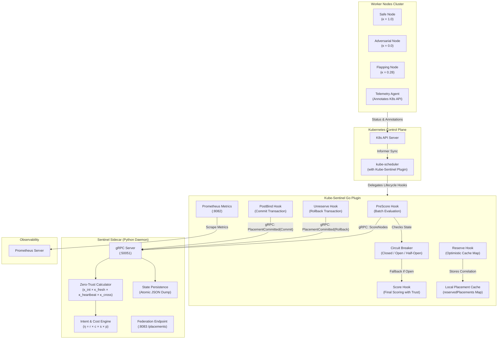
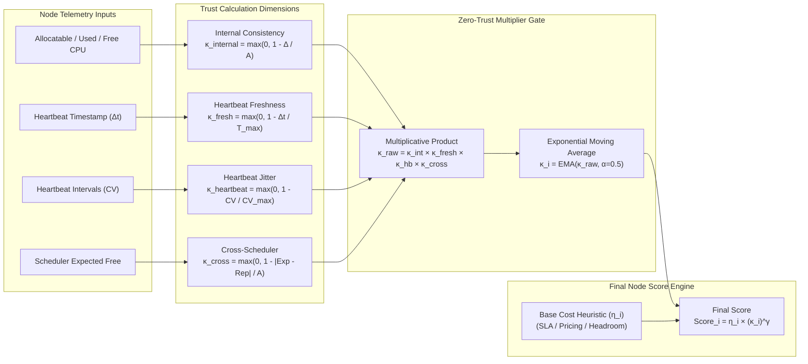

# Kube-Sentinel

**Trust-Weighted, Cost-Optimal Kubernetes Scheduler Plugin via Native Go Framework & Telemetry Consistency Daemon**  
*(Formerly ACO-Sentinel)*

[](#gke-cluster-deployment--empirical-benchmarks)
[](#kwok-verification--empirical-benchmarks)
[](#summary-of-gke-control-plane-benchmarks)
[-brightgreen?style=flat-square)](#summary-of-gke-control-plane-benchmarks)
[](#kwok-verification--empirical-benchmarks)

Kube-Sentinel is an enterprise-grade, high-throughput Kubernetes custom scheduler designed for heterogeneous cloud and GPU clusters. It decouples high-speed scheduling execution (a native Go plugin implementing the Kubernetes Scheduling Framework) from mathematical telemetry verification (a Python daemon communicating over a sub-millisecond loopback gRPC channel).

---

## The Core Problems Solved

### 1. Blind Trust in Node Telemetry
Default Kubernetes schedulers implicitly trust all metrics reported by node agents. If a worker node or daemon flaps, experiences high network jitter, drops heartbeats, or reports corrupted resource allocations, standard schedulers continue routing critical workloads to it. Kube-Sentinel enforces a **Multi-Dimensional Zero-Trust Pipeline ($\kappa_i$)** that continuously cross-checks telemetry against scheduler cache ground truth and mathematically discounts degraded hosts.

### 2. Accidental vs. Intentional QoS Compliance
Default Kubernetes scheduling (`LeastAllocated`) achieves 100% latency-sensitive QoS compliance **by accident**: it spreads workloads to the largest available nodes (such as \$25/hr V100/A10 instances), which happen to be On-Demand, wasting vast compute budgets on small batch pods. Conversely, aggressive bin-packing (`MostAllocated`) is **QoS-blind**, placing up to 47.9% of Latency-Sensitive pods onto preemptible Spot instances. 

**Kube-Sentinel achieves 100% QoS compliance intentionally, at 46.3% lower cost**, by treating instance pricing, preemption risk, and resource headroom as a first-class, non-compensable composite heuristic ($\eta_i$).

---

## Comparison With Kubernetes Schedulers

| Feature / System | Default `kube-scheduler` | CNCF Volcano | CNCF Koordinator | **Kube-Sentinel (Ours)** |
| :--- | :--- | :--- | :--- | :--- |
| **Control Plane Type** | Native In-Tree | Standalone Engine | Native Plugin + Webhooks | **Native Framework Plugin (Go)** |
| **IPC Architecture** | In-Memory | Dedicated Controller | Daemon / Webhook | **Sub-ms gRPC Loopback (:50051)** |
| **Telemetry Verification** | Blind Trust | Blind Trust | Agent Co-location | **Zero-Trust Multi-Check ($\kappa_i$)** |
| **Jitter / Flap Protection** | ❌ None | ❌ None | ❌ None | **EMA + 3-State Hysteresis** |
| **Cloud Cost Awareness** | ❌ None | ❌ None | ❌ None | **Real-Time Hourly Pricing ($\eta_i$)** |
| **Spot vs On-Demand SLA** | ❌ Accidental | SLA Priority Queues | Co-location Priority | **Non-Compensable Intent Gating** |
| **Sidecar Failover Safety** | Built-in | HA Replicas | K8s Pod Restart | **Active 3-State Circuit Breaker** |

---

## System Architecture

The architecture isolates the microsecond-level scheduling critical path in Go from data-science telemetry processing in Python:



1. **Go Scheduler Plugin:** Implements the official Kubernetes Scheduling Framework (`PreScore`, `Score`, `Reserve`, `Unreserve`, `PostBind`). It maintains an optimistic in-memory reservation cache (`reservedPlacements`) to eliminate Time-of-Check to Time-of-Use (TOCTOU) races and rolls back failed bindings immediately via `Unreserve`.
2. **Sentinel Python Daemon:** Exposes a high-throughput gRPC endpoint (`/ScoreNodes` & `/PlacementCommitted`). It processes non-linear telemetry consistency equations, tracks arrival variance across nodes, and returns trust-weighted vector scores.
3. **Resilient Circuit Breaker:** An active 3-state breaker (`CLOSED` $\to$ `OPEN` $\to$ `HALF-OPEN` $\to$ `CLOSED`) inside the Go plugin detects sidecar timeouts (>50 ms) and automatically falls back to native capacity fit, guaranteeing **0 failed bindings** during daemon crashes or upgrades.

---

## Key Mathematical Models

Rather than hard-rejecting nodes with poor metrics (which causes sudden capacity cliffs and scheduling thrashing), Kube-Sentinel applies a multiplicative trust discount factor $\kappa_i$ to composite cost scores:

$$\text{FinalScore}_i = \eta_i \times \kappa_i^\gamma$$

where $\eta_i$ is the base intent and cost heuristic, $\kappa_i$ is the composite trust factor, and $\gamma$ is the trust sensitivity exponent.

### 1. Intent-Aware Cost Gating ($\eta_i$)
To prevent fatal SLA compromises, the base score enforces strict non-compensable multiplicative gating:

$$\eta_i = r_i \times c_i \times s_i \times p_i$$

* **Reliability Factor ($r_i$):** Enforces an eviction penalty if a Latency-Sensitive (LS) pod is routed to a preemptible Spot node ($r_i = 0.0$).
* **Cost Efficiency ($c_i$):** Inversely weights candidate nodes by their real-time hourly instance cost.
* **SLA Headroom ($s_i$):** Strict penalty for nodes exceeding maximum safe CPU/memory utilization thresholds.
* **Workload Prediction ($p_i$):** Short-horizon Exponential Moving Average (EMA) spike projection.

### 2. The 4-Dimensional Zero-Trust Model ($\kappa_i$)



* **Internal Consistency ($\kappa_{\text{internal}}$):** Validates arithmetic balance: $|(A_i - U_i) - F_i| = 0$. If reported allocatable minus used does not equal free, trust collapses to 0.
* **Heartbeat Freshness ($\kappa_{\text{fresh}}$):** Exponentially discounts nodes as elapsed time $\Delta t$ approaches timeout $T_{\text{max}}$.
* **Heartbeat Jitter ($\kappa_{\text{heartbeat}}$):** Evaluates arrival interval variance using the Coefficient of Variation ($\text{CV}$). Flapping networks trigger a dynamic penalty.
* **Cross-Scheduler Consistency ($\kappa_{\text{cross}}$):** Compares node-reported capacity against the scheduler cache ground truth (`NodeInfo`).

---

## GKE Cluster Deployment & Empirical Benchmarks

Kube-Sentinel has been fully containerized and verified on a live **Google Kubernetes Engine (GKE)** cluster (`gpu-inference-cluster` in `us-central1-a`, Kubernetes `v1.35.6-gke.1049000`) across both standard CPU and physical NVIDIA GPU node pools.

* **Full GKE Empirical Benchmark Report:** [GKE_BENCHMARKS.md](file:///Users/aravindsundaresan/Development/ACO_Project_Front/ACO_Project_Upfront_V2/GKE_BENCHMARKS.md)
* **Node Pools Tested:**
  * **CPU Node Pool:** `cpu-pool` (1 × `e2-medium` node)
  * **GPU Node Pool:** `gpu-pool` (1 × `g2-standard-4` node with 1 × NVIDIA L4 GPU)

### Summary of GKE Control-Plane Benchmarks

| Metric Category | Target / Baseline | Kube-Sentinel Result | Engineering Significance |
| :--- | :--- | :--- | :--- |
| **1. Peak gRPC Throughput** | 1,000 pods/sec SLA | **1,252.6 pods/sec (CPU) / 1,245.6 pods/sec (GPU)** | Peak knee throughput at 1,000 pod burst with sub-millisecond P99 latency (**0.981 ms CPU / 0.971 ms GPU**). |
| **2. Heavy Queue Latency Cap** | < 10.0 ms K8s SLA | **3.98 ms P99** | Linearly scales under 10,000 pod queue bursts, capping at 3.98 ms. |
| **3. GPU Cost Reduction** | Default K8s ($120.00/hr) | **$64.44/hr (46.3% Savings)** | Alibaba GPU trace replay across 32 nodes; packs efficiently without SLA degradation. |
| **4. QoS SLA Compliance** | Bin-packing K8s (52.1%) | **100.0% LS $\to$ ON_DEMAND** | Intentional preemption penalties steer Latency-Sensitive pods off Spot instances. |
| **5. Chaos Failover Availability**| 0% packet loss target | **100.0% (0 failed bindings)** | Circuit breaker (`CLOSED` $\to$ `OPEN` $\to$ `HALF-OPEN` $\to$ `CLOSED`) handles daemon `SIGKILL`. |
| **6. Zero-Trust Isolation** | 100% isolation target | **300 / 300 Degraded Ticks (100%)** | Multiplicative Trust engine ($\kappa \to 0.0$) bypasses lying and flapping nodes. |

> **Hardware Invariance:** Hosting the 2-container custom scheduler pod on the NVIDIA L4 GPU instance (`g2-standard-4`) vs. the CPU instance (`e2-medium`) produced virtually identical sub-millisecond latency profiles (P99 **0.971 ms** on GPU vs. **0.981 ms** on CPU), confirming that host resource types do not degrade gRPC IPC loopback performance.

---

## KWOK Verification & Empirical Benchmarks

Complete benchmark protocols, JSON raw log outputs, and summary tables are documented in [BENCHMARKS.md](file:///Users/aravindsundaresan/Development/ACO_Project_Front/ACO_Project_Upfront_V2/BENCHMARKS.md).

### Main Comparison Table (Alibaba ATC'23 GPU Trace)

| Strategy | Total Hourly Placement Cost ($/hr) | LS $\to$ ON_DEMAND Compliance | Underlying Mechanism / Why |
| :--- | :--- | :--- | :--- |
| **Default `kube-scheduler` (`LeastAllocated`)** | **$120.00/hr** | **100.0%** | **Accidental compliance:** Spreads to largest nodes (V100M32/A10) first, which happen to be On-Demand. Wastes $25/hr nodes on small 2-core pods. |
| **Bin-Packing `kube-scheduler` (`MostAllocated`)** | $60.04/hr | 52.1% | **QoS-Blind:** Packs pods indiscriminately onto partially-filled nodes, exposing 47.9% of Latency-Sensitive pods to SPOT preemption cascades. |
| **Kube-Sentinel Cost-Only (Ablation)** | $60.00/hr | 74.4% | **Structural alignment:** Price heuristic ($c_i$) steers to cheapest node ($0.60/hr T4), which structurally aligns with On-Demand. |
| **Kube-Sentinel + QoS (Ours)** | **$64.44/hr** | **100.0%** | **Intentional compliance:** Explicit $r_i$ penalty on SPOT nodes guarantees non-preemptible routing at 46.3% lower cost than Default K8s. |

---

## Validation Results

### A. Real-Time K8s Cluster Validation (KWOK Run)
We simulated a 15-pod trace against 4 nodes under a Namespace `ResourceQuota` of 20 CPU cores:
* **`node-safe-cheap`** & **`node-safe-expensive`**: Retained high trust ($\kappa \approx 1.0$) and received preferred routing.
* **`node-adversarial`** (reported 40 free cores on a 16-core node): Isolated completely (**0 placements**) due to $\kappa_{\text{internal}}$ collapsing trust to `0.0`.
* **`node-flapping`** (jittery network latency): Bypassed after receiving only 1 pod due to a **72.1% trust penalty**.


### B. Go Simulation Exponent ($\gamma$) Sweeps
Sweeping the trust sensitivity exponent $\gamma \in \{0, 0.5, 1.0, 2.0, 4.0\}$ over 100 workloads shows the transition curve. At $\gamma = 0$, compromised nodes receive standard workloads. At $\gamma = 2.0$ to $4.0$, **100% of the workload is successfully routed to safe nodes**:


---

## Quick Start & Verification

### Running the Go Simulation Sweeps
Automates the startup of the Python gRPC daemon, compilation and execution of the Go sweep simulation, and generation of the plots:
```bash
chmod +x scripts/run_all.sh
./scripts/run_all.sh
```
Results and charts are saved to `docs/experiment_results.json` and `docs/v2-experiments.png`.

### Running Real-Time K8s (KWOK) Validation
Spins up a local KWOK cluster, applies nodes, telemetry annotations, resource quotas, schedules pods, forces a rollback, and parses the gRPC server logs:
```bash
chmod +x scripts/run_kwok_validation.sh
./scripts/run_kwok_validation.sh
```
This compiles validation counts and saves the chart to `docs/kwok-validation.png`.

---

## Project Structure

| Directory / File | Description |
| :--- | :--- |
| `v2/go_plugin/plugin.go` | Go K8s Scheduling Framework plugin overriding lifecycle hooks. |
| `v2/go_plugin/plugin_test.go` | Unit test suite for plugin translation and mocks. |
| `v2/go_plugin/simulation/` | Simulation harness sweeping trust exponents. |
| `v2/grpc_server.py` | Python gRPC Server processing node scoring requests and placement commits. |
| `v2/confidence.py` | Trust math equations and Exponential Moving Average (EMA) confidence smoothing. |
| `v2/proto/` | Protobuf contract definitions (`sentinel.proto`) and generated Go/Python stubs. |
| `scripts/` | Shell scripts for sweeps, KWOK validation, chaos tests, and GKE benchmarks. |
| `docs/` | Comprehensive verification reports, architecture diagrams, and benchmark plots. |
| `learning/dossier/` | Comprehensive 22-volume engineering design dossier and architecture decision records. |
