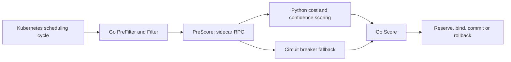

# Kube-Sentinel

A native Kubernetes scheduler plugin that combines placement constraints, cost-aware scoring, and telemetry consistency checks.

Kube-Sentinel is a portfolio engineering project. The current baseline is [v0.1.0](https://github.com/Aravind0403/Kube-Sentinel/releases/tag/v0.1.0); this branch cleans up its implementation and public interface. Local bindings and native daemon failover have been tested. The cluster outage/recovery scenario still needs stronger evidence before cloud acceptance.

## What it does

- Keeps protected latency-critical workloads off recognized Spot capacity.
- Filters CPU architecture, GPU requirements, explicit cost ceilings, and unacceptable telemetry.
- Uses a Python sidecar for cost and telemetry-confidence scoring.
- Keeps native Go filters active when the sidecar is unavailable; a circuit breaker supplies neutral fallback scores.
- Tracks placement commit/rollback through scheduling lifecycle hooks.

Pricing and optional observations are supplied as node metadata. The project does not automatically discover current cloud prices or collect trustworthy host utilization. Absent optional observations use defaults; supplied malformed observations are rejected. Consistency checks cannot authenticate a node that reports internally consistent false data.

## Architecture



The custom scheduler is selected through `spec.schedulerName`. Standard Kubernetes resource and affinity filters remain enabled in the local profile. This is a per-Pod scoring path; it does not perform global batch optimization.

## Run the native acceptance tests

Requirements: Go matching `v2/go_plugin/go.mod`, Python 3.11 or newer, and a local environment that permits test subprocesses and loopback sockets.

```sh
python3 -m venv .venv
. .venv/bin/activate
python -m pip install -r requirements.txt
export SENTINEL_ACCEPTANCE_PYTHON="$(command -v python)"
(cd v2/go_plugin && go test -race -count=1 -v ./...)
python v2/verify_confidence.py
```

Setting `SENTINEL_ACCEPTANCE_PYTHON` is required to execute the real daemon failover test. Without it, that test skips. CI sets it explicitly.

## Run the local cluster fixtures

Install kind, kubectl, and a working Docker or Podman runtime. Allow enough resources for one control-plane container and three worker containers; the runner builds images for the host architecture.

```sh
bash scripts/run_local_acceptance.sh
```

The runner creates and deletes a dedicated disposable kind cluster. It changes the current kubectl context; restore your previous context afterward. Use an isolated kubeconfig when working alongside other clusters. `KEEP_CLUSTER=true` retains the test cluster for debugging.

Evidence is written to `artifacts/local-acceptance/<run-id>/`: run configuration, scenario results, Pod bindings, events, and logs. New runs are ignored by Git; explicitly add selected reviewed evidence when publishing a result.

**Known acceptance limitation:** the inherited L8 test can report PASS without proving that the daemon was unavailable during binding or that native scoring resumed. Treat its result as provisional until the outage assertions described in [validation status](docs/validation.md) are implemented and rerun. A second Pod binding alone is insufficient proof.

## Submit a workload

Use the local cluster fixtures first; they supply the metadata needed by the price and telemetry policies.

```yaml
apiVersion: v1
kind: Pod
metadata:
  name: protected-example
  labels:
    kube-sentinel.io/workload-type: latency-critical
  annotations:
    sentinel.cost/ceiling-usd: "1.00"
spec:
  schedulerName: kube-sentinel-scheduler
  restartPolicy: Never
  containers:
    - name: worker
      image: alpine:3.19
      command: ["sleep", "60"]
      resources:
        requests:
          cpu: 50m
          memory: 64Mi
```

The ceiling requires known node pricing. Recognized GKE Spot metadata includes `cloud.google.com/gke-spot=true`. Additional policy keys are defined in `v2/go_plugin/plugin.go`; examples and all active fixtures use the new interface.

## What the evidence establishes

| Evidence | Supported conclusion | Limit |
|---|---|---|
| 39-case observation matrix | Optional, valid, malformed and unacceptable observations are handled by the native filter | Fixture coverage |
| Native Go/Python failover | Real daemon termination, neutral fallback, breaker recovery on the same connection | No Kubernetes API or Pod binding in this test |
| Archived kind L1–L7 | Real fixture Pod bindings and intended unschedulable outcomes | Archived before the interface rename; rerun this branch |
| Archived kind L8 | Two Pods bind | Outage interval and recovered scoring are not established |
| Offline policy replay | Modeled placement/admission tradeoffs | Different admitted work; no cloud bill savings proof |
| gRPC benchmark | Scoring RPC latency and throughput | Not Pods bound per second |

[Historical local artifacts](artifacts/local-acceptance/local-20261022-165257/) are retained unchanged for provenance, including their original names. There is no production SLA, verified physical GPU performance claim, or equivalent-work cloud savings claim for this release.

## Optional experiments

Run from the repository root with the Python environment active:

```sh
python scripts/replay_policy.py --jobs 50
python scripts/benchmark_grpc.py --candidate-nodes 16 --max-burst 250
python scripts/benchmark_telemetry.py --ticks 3
```

The socket experiments start a local sidecar when their loopback endpoint is unused. Outputs go to ignored `artifacts/benchmarks/`. The replay is a synthetic workload generator informed by a published cluster profile, not an execution of a downloaded production trace or the live Kubernetes scheduler.

## Repository map

| Path | Purpose |
|---|---|
| `v2/go_plugin/` | Native plugin, circuit breaker and acceptance tests |
| `v2/grpc_server.py`, `v2/confidence.py` | Sidecar and telemetry-confidence logic |
| `v2/proto/` | RPC schema and generated bindings |
| `core/orchestrator/` | Shared scoring models and cost engine used by the sidecar |
| `k8s/local/` | Disposable local-cluster profile |
| `scripts/` | Local acceptance and three scoped experiments |
| `artifacts/local-acceptance/` | Preserved release evidence |
| `docs/` | Validation, interface migration, cleanup and next cloud checks |

Retired implementations, personal drafts, obsolete infrastructure and old charts are recoverable from Git history. See [migration notes](docs/migration.md) before updating an existing deployment. For the next stage, see the [Google Cloud check plan](docs/google-cloud-checks.md).
